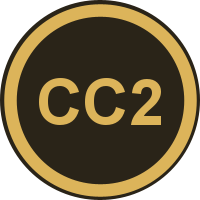

<div align="center">



# Counter-Craft 2

**Counter-Strike-inspired gameplay, weapons, agents, cosmetics and audio in Minecraft survival.**

A free, fan-made Fabric mod for Minecraft: Java Edition.

[](../../releases)
[](https://www.minecraft.net/)
[](https://fabricmc.net/)
[](https://adoptium.net/)
[](LICENSE)

<a href="https://youtu.be/MykB04JJEKU"></a>

**▶ [Watch the BETA trailer on YouTube](https://youtu.be/MykB04JJEKU)**

[Download](../../releases) · [Trailer](https://youtu.be/MykB04JJEKU) · [Install](#installation) · [Servers](#playing-on-a-server) · [FAQ](#faq) · [Build from source](#building-from-source)

</div>

> [!IMPORTANT]
> **Unofficial fan project.** Counter-Craft 2 is not an official Valve product and is not affiliated with, sponsored by,
> approved by or endorsed by Valve Corporation, Microsoft or Mojang Studios.
> NOT AN OFFICIAL MINECRAFT PRODUCT. NOT APPROVED BY OR ASSOCIATED WITH MOJANG OR MICROSOFT.

---

## Contents

- [Features](#features)
- [No Counter-Strike files included](#no-counter-strike-files-included)
- [Requirements](#requirements)
- [Installation](#installation)
- [Updating](#updating)
- [Playing on a server](#playing-on-a-server)
- [FAQ](#faq)
- [Building from source](#building-from-source)
- [Third-party software](#third-party-software)
- [License](#license)

## Features

**Weapons and combat**
- The Counter-Strike 2 arsenal: rifles, SMGs, pistols, snipers, shotguns, knives and grenades, each with its own stats.
- Spray patterns measured in Counter-Strike 2, first-person viewmodels with their animations, recoil and inaccuracy.
- A buy menu with an in-game economy: kill rewards, armor, utility and refunds.
- Grenade binds (HE, flashbang, smoke, decoy, molotov), unbound by default as in CS2.

**Survival, the Counter-Craft way**
- A day-and-night round loop on top of Minecraft survival, with a buy phase each morning and rewards for each day survived.
- CS2 movement that still answers to Minecraft: Speed, Slowness, Jump Boost, Slow Falling, Levitation, soul sand and
  honey change it as they would in Minecraft.
- Surf ramps: the 45° slope of any stair, crafted from that stair and a feather. With CS movement you surf them;
  operators can raise `sv_airaccelerate` (up to 500, saved per world) for surf servers.
- Hardcore co-op with *Another Chance*: spectate your teammates, then respawn at dawn if anyone made it through the night.
  In hardcore, a player list shows where everyone is (or that they're dead), with their skin's face.
- Terrorist and Counter-Terrorist teams as a cosmetic identity, with agent models, voice lines and radio calls. An
  optional X-ray shows your teammates through walls in their team colour (in hardcore, everyone).

**Presentation**
- A Counter-Strike-style HUD, scoreboard, MVP and round-end panels, death cam and ragdolls.
- A full crosshair editor that can import Counter-Strike 2 crosshair share codes.
- Loadouts with agents, weapon finishes, gloves and music kits. Link your Steam account (optional, public data only) to
  use the ones you own.
- Weapon sound styles: Counter-Strike 2's, or CS:GO's if you have it installed.
- `cl_drawhud 0` hides the whole HUD for clean recordings, keeping your hands and weapon on screen (unlike F1).
- GPU-skinned player models, lit viewmodels, FXAA / TAA and texture quality settings.

**Servers**
- A dedicated server window with an overview, players, console, mods and a ban list you can unban from without a restart.

## No Counter-Strike files included

This repository and the release downloads contain **none of Valve's game files or data**: no models, textures, sounds,
music, animations, maps, fonts or weapon data.

```
Your Counter-Strike 2 install  ──►  Counter-Craft 2 installer  ──►  Asset pack + weapon table  ──►  Minecraft
        (Steam, on your PC)            (converts on your PC)            (stays on your PC)
```

The installer builds everything the mod needs **on your own PC, from your own installed copy of Counter-Strike 2**. The
asset pack it builds contains Valve's work and is for your personal use with games you own: please don't share, upload or
sell it.

## Requirements

| | |
|---|---|
| **System** | Windows 10 or 11 |
| **Games** | Counter-Strike 2, installed through Steam. Counter-Strike: Global Offensive optionally, for its weapon sounds |
| **Minecraft** | Minecraft: Java Edition, with the Minecraft Launcher, Prism Launcher or MultiMC |
| **Java** | Nothing to install: the installer app brings its own Java (the plain `.jar` needs Java 25), and your launcher runs Minecraft with its own |
| **Disk space** | About 66 GB free while the asset pack builds; about 16 GB stays |
| **Time** | A few hours for the first build (2.5 to 4 hours measured) |

## Installation

1. Download **`CC2-Installer-Beta-1.2-Windows.zip`** from [Releases](../../releases) and unzip it.
2. Open the **Counter-Craft 2 Installer** folder and double-click **`Counter-Craft 2 Installer.exe`**. If Windows says it
   protected your PC, choose **More info**, then **Run anyway** (the installer isn't code-signed).

   Not on Windows, or rather have a single file? **`CC2-Installer-Beta-1.2-Universal.jar`** is the same installer without
   the app around it: double-click it, or run `java -jar CC2-Installer-Beta-1.2-Universal.jar`. It needs Java 25; if
   whatever Java opens it is older, it finds a Java 25 on your PC (Minecraft's own counts) and opens with that.
3. Read the notices and licenses, then go through the steps:

   | Step | What happens |
   |---|---|
   | **Counter-Strike** | Your games are found through Steam. The first time, the installer offers to download the pack builder's free tools (Source 2 Viewer, FFmpeg, uv) from their official GitHub releases; Counter-Craft 2 doesn't include them. |
   | **Destination** | Pick one launcher. Counter-Craft 2 gets a profile or instance of its own, with the mod and asset pack inside; nothing else is changed. |
   | **Review** | The plan, the time it should take and the disk space each drive needs. |
   | **Progress** | The asset pack is built, installed and checked. |

4. Open your launcher, choose the **Counter-Craft 2** profile or instance, and press Play.

## Updating

Open the installer. From BETA 1.1 on it tells you when a newer release is out and can update itself (**Update
Installer**: downloaded from this repository's releases and checked against GitHub's checksum before it's used).

Its Welcome page lists the Counter-Craft 2 installs on your PC and their release. **Update** brings one up to date: when
the new release didn't change the asset pack, only the mod, Fabric API, the loader and the weapon table are replaced, in a
few seconds. When it did, the pack is rebuilt (only then), and only files that differ are copied into your install.
Worlds and settings stay as they are.

## Playing on a server

A server needs:

1. **`CC2-Server-Beta-1.2.jar`** (from [Releases](../../releases)) and [Fabric API](https://modrinth.com/mod/fabric-api) in its `mods` folder
   (Minecraft 26.3, Fabric Loader 0.19.5).
2. **The weapon table**: copy `config/countercraft/weapons.json` from a Counter-Craft 2 install into the server's
   `config/countercraft/` folder.

Each player uses the asset pack built from their own copy of Counter-Strike 2. Players need the same Counter-Craft 2
version as the server: anyone else is told which version the server runs when they try to join.

On a server, a player who reaches 5 team kills or 500 team damage (CS2 health points) is banned from it permanently, with
warnings on the way. Operators and the host of an open-to-LAN world are exempt. Change or turn off the limits with
`/mp_teamkill_ban <n>` and `/mp_teamdamage_ban <n>` (0 turns one off).

## FAQ

<details>
<summary><b>Do I need to own Counter-Strike 2?</b></summary>

Yes. The installer builds the asset pack and the weapon table from your own Counter-Strike 2 install, and the mod needs
both to run.
</details>

<details>
<summary><b>Can I share the asset pack?</b></summary>

No. It's made from Valve's files and is for your personal use only. Anyone who wants it can run the installer on their own
copy of Counter-Strike 2.
</details>

<details>
<summary><b>Does linking Steam put my account or items at risk?</b></summary>

No. Linking is optional. Counter-Craft 2 never asks for your password and can't trade or move items: it only reads what
your public profile already shows.
</details>

<details>
<summary><b>I linked Steam, but a skin I own isn't unlocked</b></summary>

If it was traded to you in the last 7 days, it's trade protected, and Steam shows trade-protected items only to you
while you're signed in, never in your public inventory. Counter-Craft 2 sees it once the protection ends: press
**Refresh inventory** then. Until then, Skinchanger Mode unlocks it (without the Genuine Skins ✓).
</details>

<details>
<summary><b>Can I use Counter-Craft 2 in a video or on a server?</b></summary>

Yes. Please credit Counter-Craft 2, and follow Mojang's and Valve's own rules for videos and servers.
</details>

<details>
<summary><b>Double-clicking the Universal jar does nothing</b></summary>

Windows is opening `.jar` files without `-jar` (this happens after choosing Java through "Open with"). Use the Windows
download (`CC2-Installer-Beta-1.2-Windows.zip`, double-click `Counter-Craft 2 Installer.exe`), or run
`java -jar CC2-Installer-Beta-1.2-Universal.jar` in a terminal.
</details>

<details>
<summary><b>Can I donate?</b></summary>

No. Counter-Craft 2 doesn't take donations, sponsors or advertising, and never will. Your donation is your enjoyment.
</details>

## Building from source

Requires a Java 25 JDK. The converter is Python, run with [uv](https://docs.astral.sh/uv/).

```bash
./gradlew build           # the mod: build/libs/
./gradlew installerExe    # the installer app (exe + its own Java): INSTALLERTESTBETA/
```

| Folder | What's inside |
|---|---|
| `src/main` | The mod's game and server code |
| `src/client` | Rendering, HUD, menus and client-side gameplay |
| `src/installer` | The installer (Swing, no dependencies) |
| `converter` | Builds the asset pack and weapon table from a Counter-Strike 2 install (`build_pack.py`) |
| `converter/measured` | Spray patterns and view punch measured in Counter-Strike 2 |

## Third-party software

| Software | License | How it's used |
|---|---|---|
| [Fabric API](https://github.com/FabricMC/fabric) | Apache 2.0 | Required by the mod, included with the installer |
| [Brotli decoder](https://github.com/google/brotli) | MIT | Inside the mod |
| [Fabric Loader](https://github.com/FabricMC/fabric-loader) | Apache 2.0 | Downloaded by your launcher |
| [Source 2 Viewer](https://github.com/ValveResourceFormat/ValveResourceFormat) | MIT | Reads Counter-Strike's files; downloaded on your PC when you ask |
| [FFmpeg](https://ffmpeg.org/) ([builds](https://github.com/BtbN/FFmpeg-Builds)) | GPL v3 | Converts sounds; downloaded on your PC when you ask |
| [uv](https://github.com/astral-sh/uv) | Apache 2.0 / MIT | Runs the converter; downloaded on your PC when you ask |
| NumPy, Pillow, OpenEXR | BSD 3-Clause, MIT-CMU, BSD 3-Clause | Used by the converter; installed by uv |

## License

Counter-Craft 2's own code is licensed under the **[PolyForm Noncommercial License 1.0.0](LICENSE)**: any noncommercial
use is permitted; commercial use is not.

```
Required Notice: Copyright (c) 2026 Steven
```

Counter-Strike, Counter-Strike 2, CS2, CS:GO and Steam are trademarks of Valve Corporation. Minecraft is a trademark of
Mojang Synergies AB. These names are used only to describe what Counter-Craft 2 works with and is inspired by.
